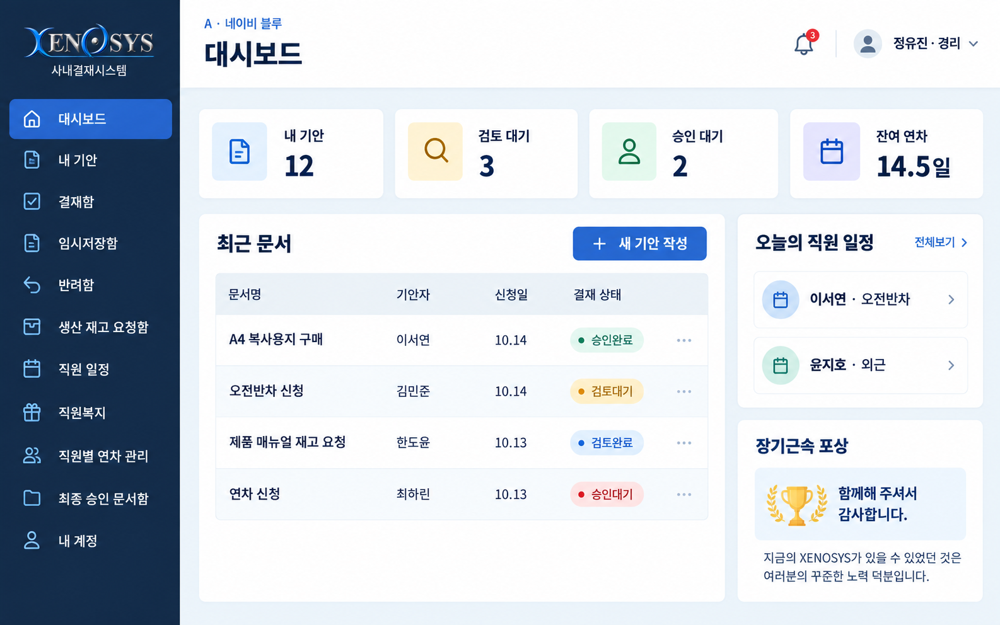
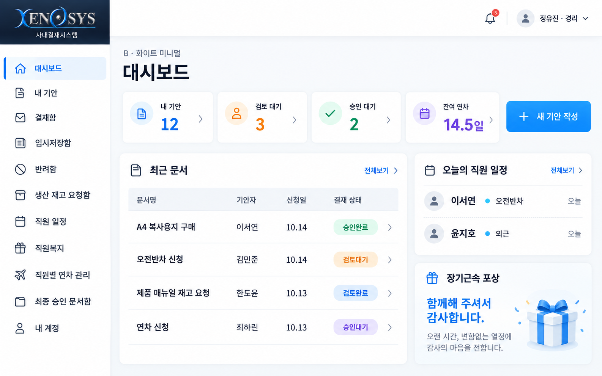
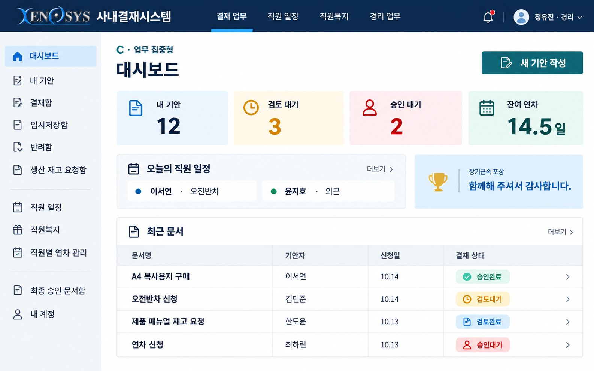

# Xenosys 사내결재시스템 디자인 시안

2026년 10월 14일 작성한 디자인 선택용 이미지입니다. 실제 프로그램에 적용하기 전의 화면 구성 제안입니다.

## A · 네이비 블루

짙은 네이비 메뉴와 파란 버튼으로 업무 영역을 구분합니다.

## B · 화이트 미니멀

흰색 메뉴와 넓은 여백으로 밝고 간결하게 구성합니다. 가독성을 중심으로 선택한다면 이 안을 추천합니다.

## C · 업무 집중형

상단 메뉴와 넓은 문서 표로 목록 확인에 집중합니다.

마음에 드는 A·B·C를 선택하거나 여러 안의 요소를 조합할 수 있습니다.
