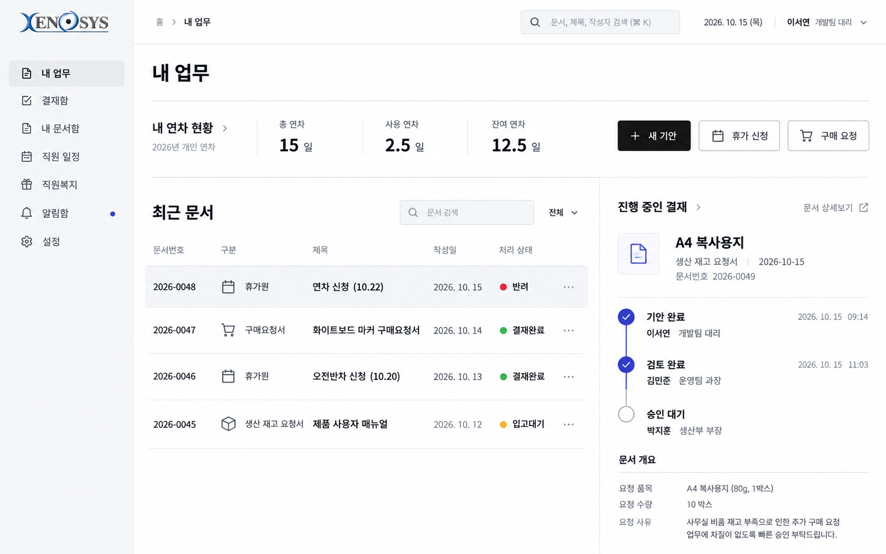
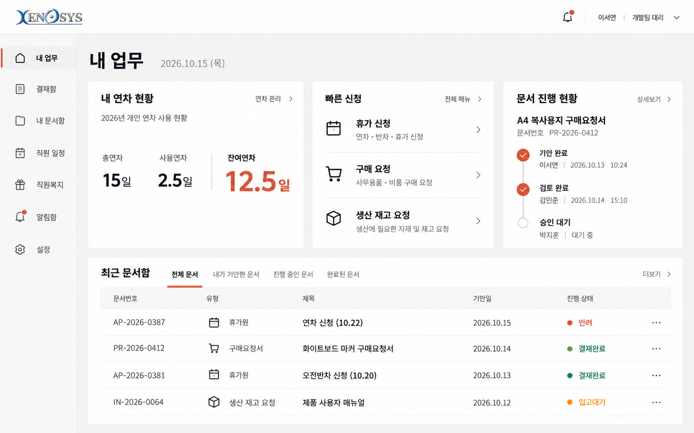
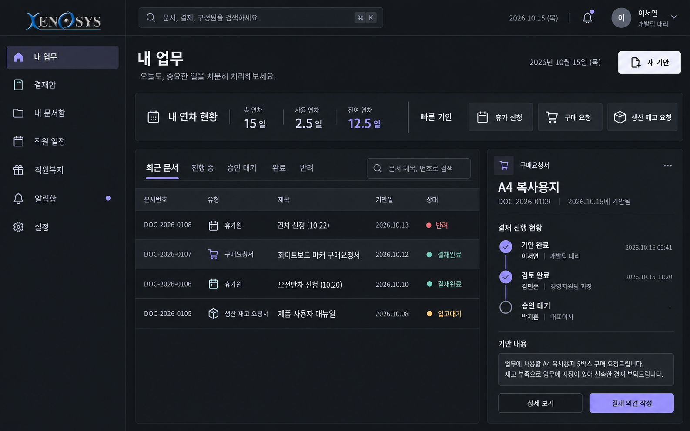

# Xenosys — 두 번째 디자인 시안

2026년 10월 15일 작성한 디자인 검토용 이미지입니다. 실제 프로그램의 화면과 기능은 변경하지 않았습니다.

앞선 시안의 큰 환영 배너와 카드 중심 구성을 덜어내고, 타이포그래피·얇은 구분선·문서 목록 중심의 새로운 방향을 비교합니다. 화면의 직원·수치·문서는 예시입니다. 문구와 실제 기능 연결은 구현할 때 정리합니다. 이미지 속 메뉴·버튼은 디자인 예시이며 신규 기능의 확정을 뜻하지 않습니다.

| 시안 | 분위기 | 주요 구성 |
| --- | --- | --- |
| D · 프리시전 | 흰색·회색·검정 중심의 정밀한 업무 도구 | 간결한 메뉴, 연차 요약, 넓은 문서 목록, 오른쪽 결재 상세 |
| E · 스튜디오 | 따뜻한 무채색과 소량의 주홍색 | 짧은 메뉴, 비대칭 요약 영역, 숫자·글자 중심의 화면 |
| F · 나이트 데스크 | 차콜색 바탕의 차분한 다크 테마 | 얇은 경계선과 밝은 글자, 문서 목록과 결재 상태 분리 |

## D · 프리시전

[이미지 크게 보기](D_precision.png)

## E · 스튜디오

[이미지 크게 보기](E_studio.png)

## F · 나이트 데스크

[이미지 크게 보기](F_night-desk.png)
