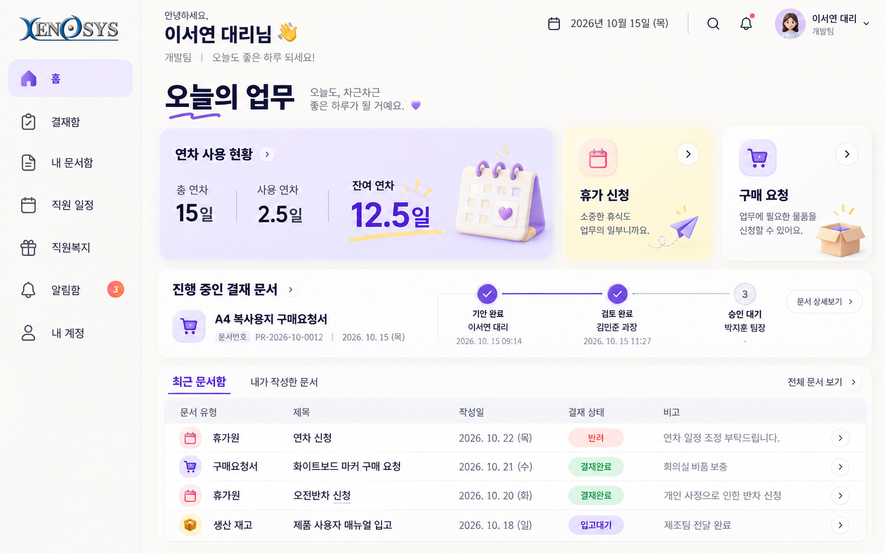
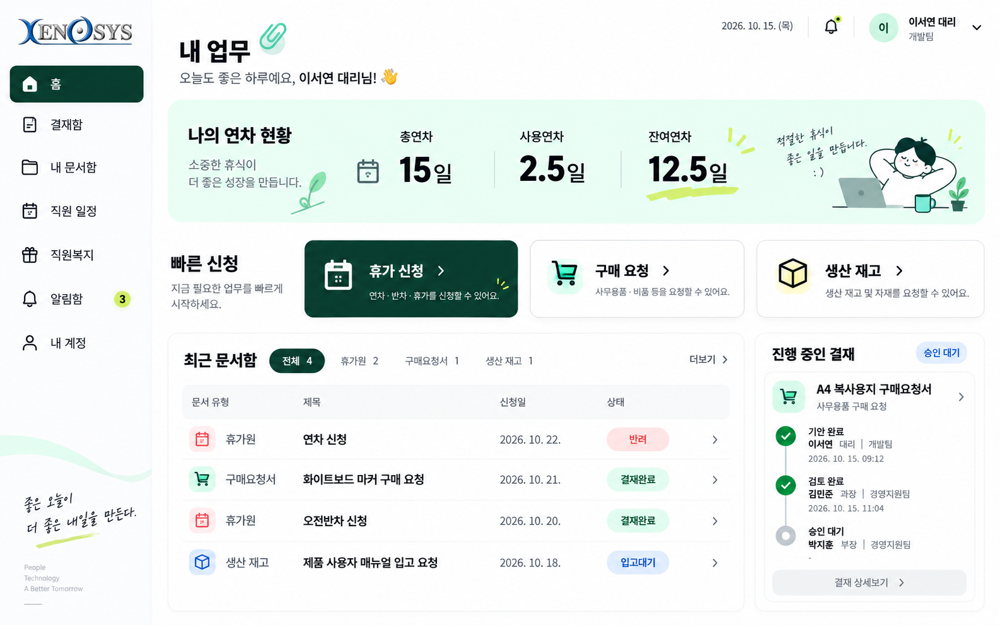
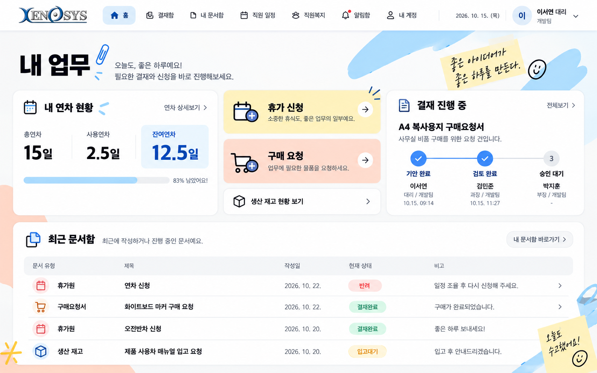

# Xenosys — 밝고 감각적인 디자인 시안

2026년 10월 15일 작성한 세 번째 디자인 검토안입니다. 실제 프로그램의 화면과 기능은 변경하지 않았습니다.

라일락·민트·스카이블루 등 새로운 색감과 개성 있는 배치로 젊고 편안한 업무 화면을 제안합니다. 총연차·사용연차·잔여연차, 기안 작성, 결재 진행, 문서 목록은 공통으로 유지합니다. 화면의 수치·문서·직원은 예시이며, 메뉴와 버튼은 실제 구현 시 기존 권한과 기능에 맞춰 연결합니다.

| 시안 | 색감과 분위기 | 구성 |
| --- | --- | --- |
| G · 라일락 데스크 | 라일락·크림색, 부드러운 입체 아이콘 | 비대칭 요약 카드와 가로 결재 단계 |
| H · 민트 플로우 | 민트·라임·짙은 초록, 또렷한 글자 | 넓은 문서 목록과 오른쪽 진행 카드 |
| I · 팝 워크스페이스 | 스카이블루·피치·레몬색, 작은 그래픽 포인트 | 상단 메뉴와 가로로 정돈한 업무 요약 |

## G · 라일락 데스크

[이미지 크게 보기](G_lilac-desk.png)

## H · 민트 플로우

[이미지 크게 보기](H_mint-flow.png)

## I · 팝 워크스페이스

[이미지 크게 보기](I_pop-workspace.png)
