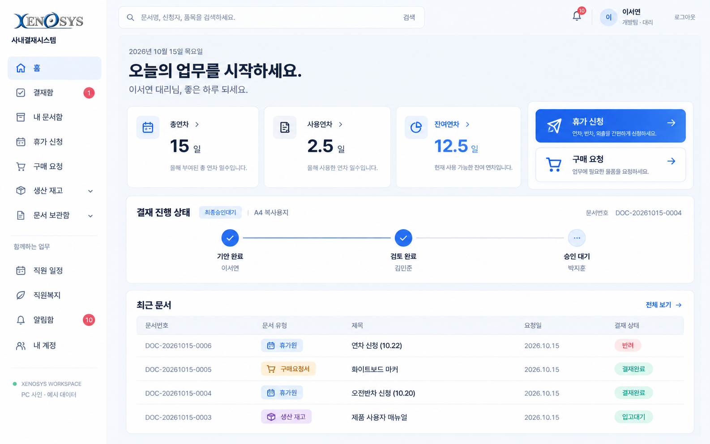
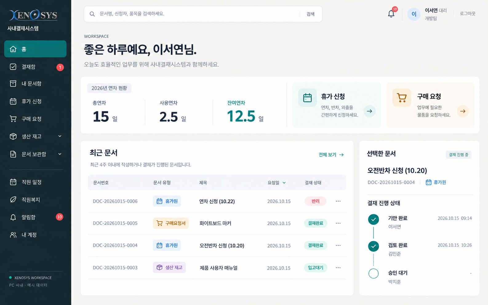
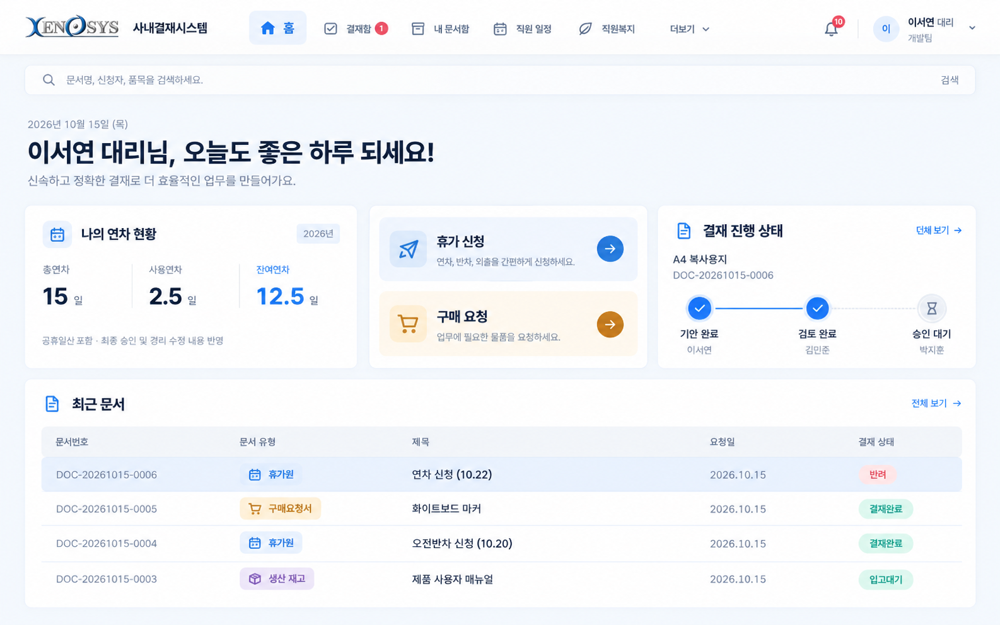

# Xenosys 사내결재시스템 — 디자인 시안 3종

2026년 10월 15일의 디자인 검토용 이미지입니다. 실제 프로그램은 변경하지 않았습니다. 화면 속 직원·문서·수치는 예시이며, 이미지의 세부 문구와 간격은 구현 단계에서 조정합니다.

개인 연차 현황, 휴가·구매 신청, 결재 진행 상태, 최근 문서 등 현재 기능을 바탕으로 서로 다른 방향을 비교합니다. 문서 선택 기능은 아직 구현하지 않았습니다.

| 시안 | 디자인 방향 | 화면 구성 |
| --- | --- | --- |
| A · 클린 워크스페이스 | 흰색과 절제된 파란색, 명확한 글자와 여백 | 밝은 왼쪽 메뉴, 간결한 연차 카드, 가로 결재 단계와 문서 표 |
| B · 프리미엄 오피스 | 짙은 네이비·따뜻한 회색·청록색 | 문서 표를 크게 배치하고 결재 진행을 오른쪽으로 분리 |
| C · 와이드 포털 | 밝고 넓은 화면, 정돈된 가로 흐름 | 왼쪽 메뉴 대신 상단 메뉴, 업무 요약과 전체 폭의 문서 표 |

## A · 클린 워크스페이스

현재 구조에서 자연스럽게 발전시키는 방향입니다. 개인 연차와 주요 업무를 빠르게 확인하고, 복잡한 장식을 줄입니다.

[이미지 크게 보기](A_clean-workspace.png)

## B · 프리미엄 오피스

차분하고 무게감 있는 방향입니다. 문서 목록이 중심이고, 진행 단계는 별도 카드에 배치합니다.

[이미지 크게 보기](B_premium-office.png)

## C · 와이드 포털

상단 메뉴를 활용해 본문 공간을 넓히는 방향입니다. 각 업무 영역을 가로로 정돈합니다.

[이미지 크게 보기](C_wide-portal.png)
