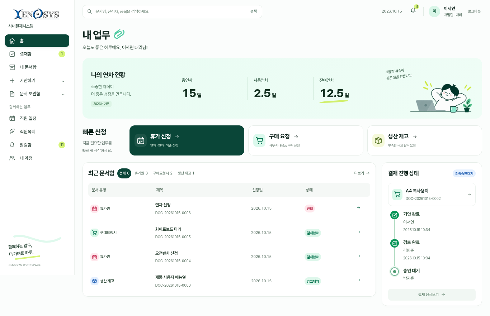
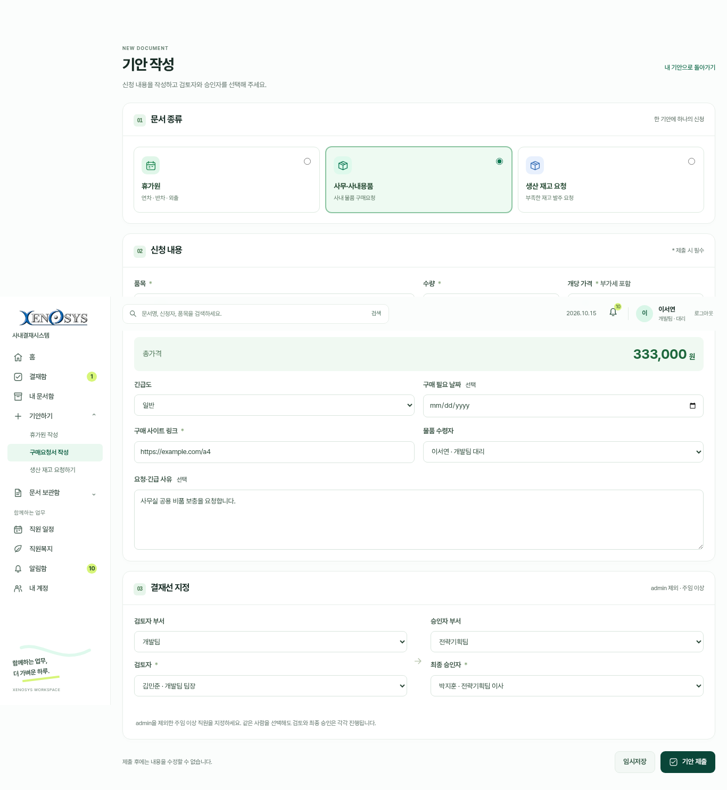
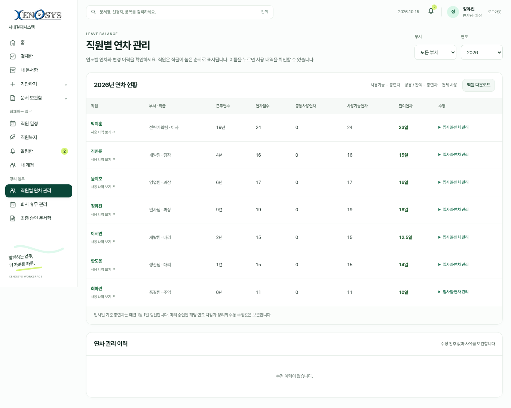
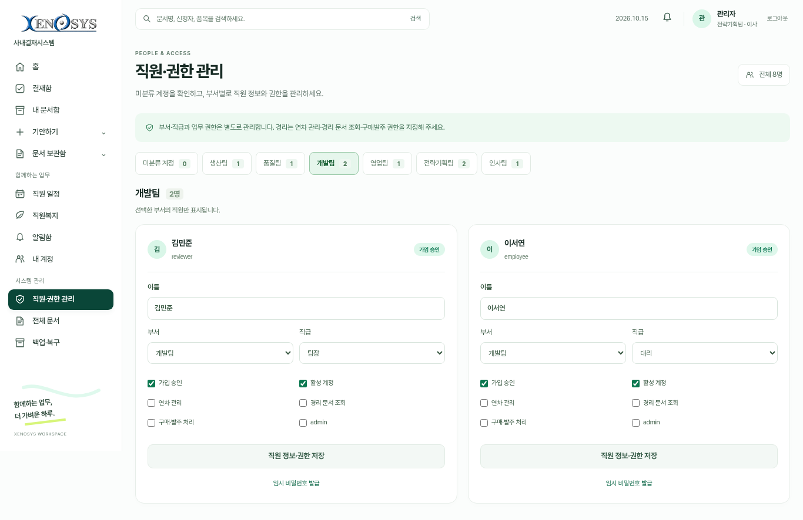

# Xenosys 사내결재시스템 — 민트 플로우 실제 화면

2026년 10월 15일, 선택한 H 시안을 적용한 프로그램 화면입니다. 가상 직원 계정으로 촬영했습니다. 녹화 없이 ZIP을 받아 직접 실행할 수 있습니다.

[Windows 실행용 ZIP](https://github.com/xenoqc23/company-approval-system/archive/refs/heads/prototype/pc-demo-20261008.zip) · [업데이트 방법](../../UPDATE_WINDOWS.txt) · [처음 실행하기](../../START_HERE.txt)

## 홈

흰색 메뉴와 초록색 강조, 본인의 연차 현황, 세 가지 빠른 신청, 종류별 최근 문서와 실제 결재 단계를 표시합니다. 왼쪽 문구는 “함께하는 업무, 더 가벼운 하루.”입니다.

창 크기 비교: [1080px](home-1080.png) · [1366px](home-1366.png) · [1920px](home-1920.png)

## 문서 작성과 결재

[휴가원 작성](leave-compose.png) · [생산 재고 요청](stock-compose.png) · [문서함](documents.png) · [결재 상세](detail.png) · [처리 완료 안내](review-feedback.png) · [검색](search.png)

## 직원 공통 화면

[직원 일정](calendar.png) · [부재 등록](absence.png) · [경조사비 안내](welfare.png) · [장기근속 포상](welfare-awards.png) · [알림함](notices.png) · [내 계정](account.png) · [로그인](login.png) · [회원가입](signup.png)

## 경리와 관리자

[연차 사용 내역](leave-history.png) · [회사 휴무 관리](company-holidays.png) · [최종 승인 문서함](accounting.png)

[미분류 계정](staff.png) · [백업·복원](backups.png)

[화면 및 업무 흐름 점검 결과](../ui-verification/README.md)
