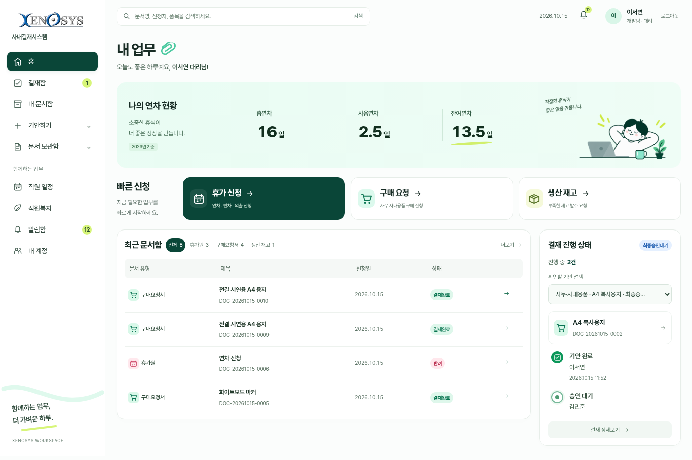
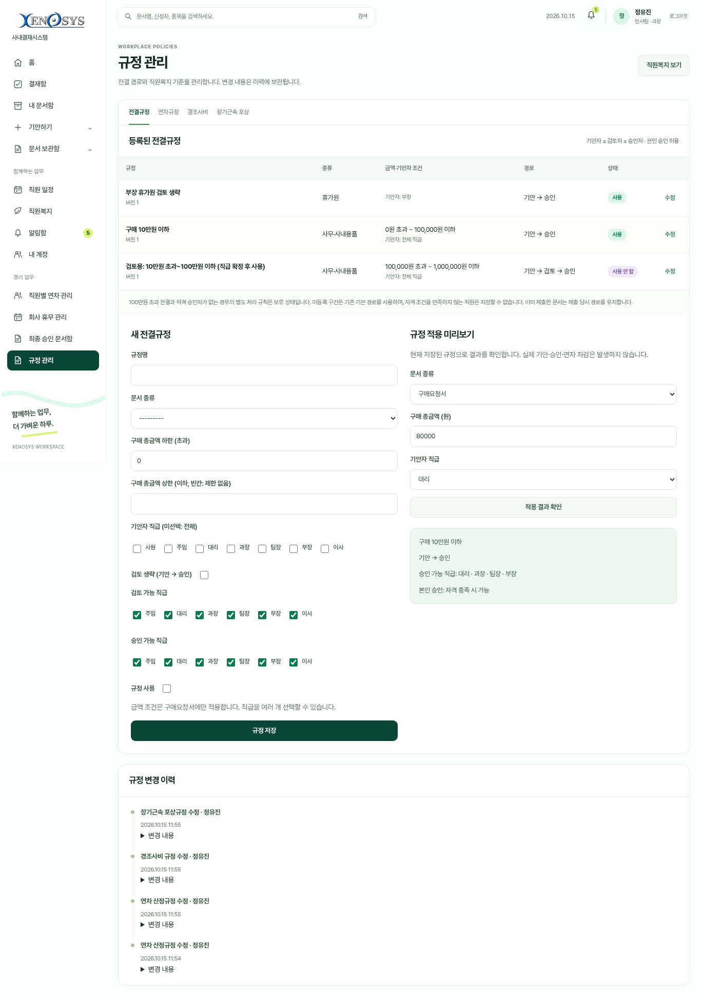
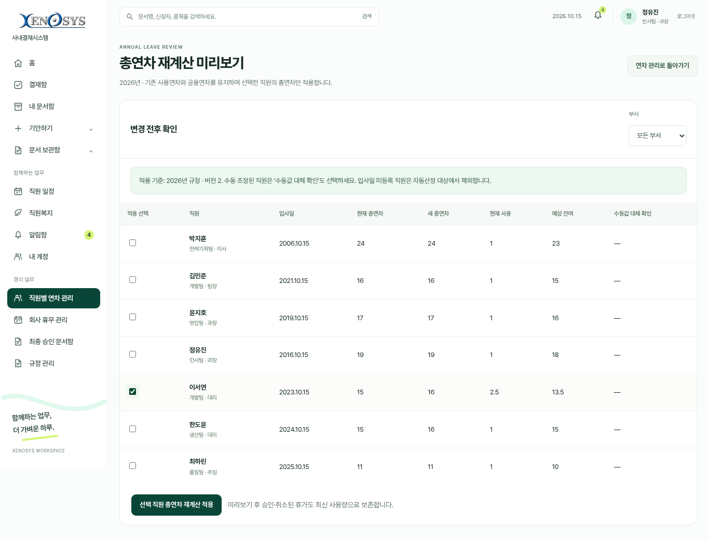

# Xenosys — NAS 연동 전 PC 검토본 실제 화면

2026년 10월 15일, 확정된 전결·연차·직원복지 변경사항을 적용한 화면입니다. 가상 직원과 별도 시험 DB에서 촬영했으며 예시 입력값을 포함합니다.

[setup·run 실행용 ZIP](https://github.com/xenoqc23/company-approval-system/archive/refs/heads/prototype/pc-demo-20261008.zip) · [기존 프로그램 업데이트](../../UPDATE_WINDOWS.txt) · [처음 실행](../../START_HERE.txt) · [직접 확인 순서](../../DEMO_CHECKLIST.txt)

## 홈과 결재

진행 중인 본인 기안만 선택할 수 있습니다. 완료·반려·취소된 문서는 내 문서함에서 확인합니다.

[진행 중 0건 화면](final-home-empty-progress.png) · [검토 생략 구매 작성](final-office-compose.png) · [두 단계 결재 상세](final-two-step-detail.png) · [부장 휴가원](final-manager-leave.png)

## 규정 관리

경리·admin은 전결규정과 적용 미리보기를 사용합니다. 경리는 연차·경조사비·장기근속 포상도 편집합니다.

[적용 연도별 연차규정](final-annual-rules.png) · [경조사비 편집](final-benefits-editor.png) · [장기근속 포상 편집](final-awards-editor.png)

## 연차 재계산과 회사 휴무

기존 총연차는 저장만으로 덮어쓰지 않습니다. 변경 전후를 확인하고 직원을 선택하여 적용하며, 수동 조정값은 대체 확인을 거칩니다.

[공용연차 중복 안내](final-company-overlap.png) · [직원별 연차 관리](annual-management.png) · [연차 사용 내역](leave-history.png)

## 기타 화면

[직원 일정](calendar.png) · [부재 등록](absence.png) · [알림함](notices.png) · [내 계정](account.png) · [부서별 직원 관리](staff-department.png) · [백업·복원](backups.png)

[최신 검증 결과 — 기능 시험 111건](../ui-verification/final-implementation.md)
