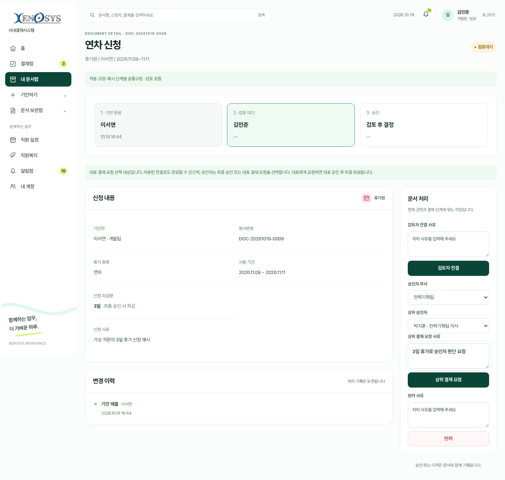
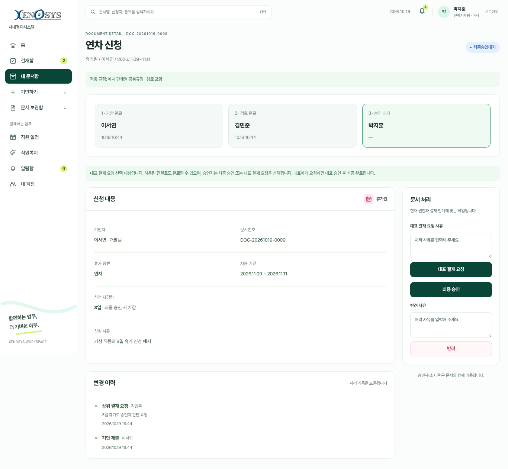
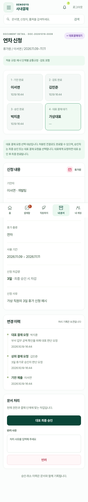

# 단계별 결재 화면 예시

실제 프로그램에서 가상 직원·가상 문서로 캡처한 화면입니다. 실제 회사 직원·연차 기록·계정 비밀번호를 포함하지 않습니다.

연차 3일·구매금액 100만원 이상은 대표 결재 요청을 선택할 수 있는 기준입니다.
기준 이상도 규정에서 허용한 검토자 전결·본인 전결로 완료할 수 있습니다.

## 잔여연차 강조

## 검토자: 전결 또는 상위 승인자 지정

## 승인자: 최종 승인 또는 대표 결재 요청

## 대표: 요청받은 문서 결재 (모바일)

